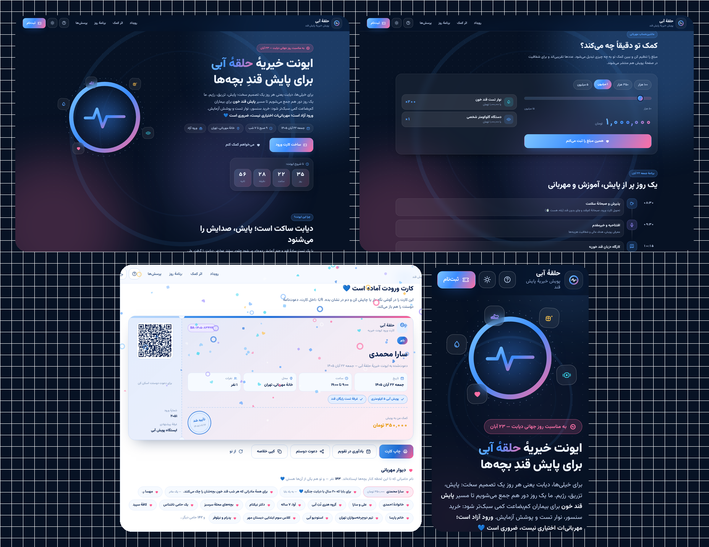

# 🔵 ایونت خیریهٔ «حلقهٔ آبی» — پویش پایش قند خون

یک **صفحهٔ فرود + دعوت‌نامهٔ تعاملی** برای یک ایونت خیریه؛ ساخته‌شده فقط با
**HTML + CSS + JavaScript خالص** (بدون فریم‌ورک، بدون CDN، کاملاً آفلاین).

موضوع پویش، همان خطِ «پایش پزشکی» است: کمک به هزینهٔ **پایش قند خون** بیماران دیابتی —
تست، سنسور، نوار و آزمایش. تاریخ نمونه: **جمعه ۲۲ آبان ۱۴۰۵** (یک روز پیش از روز جهانی دیابت).



---

## ✨ ویژگی‌ها

### برای مهمان (تجربهٔ تعاملی)
- ⏳ **شمارش معکوس زنده** تا لحظهٔ شروع ایونت (روز/ساعت/دقیقه/ثانیه)
- 🧮 **ماشین‌حساب مهربانی**: مبلغ را با اسلایدر تنظیم کن و ببین دقیقاً به چه چیزی تبدیل می‌شود
  (نوار تست، گلوکومتر، ماه پایش با سنسور…) و با یک کلیک ثبتش کن
- 🎯 **نوار هدف پویش** که با کمک تو زنده بالا می‌رود (۶۴٪ → بیشتر)
- 🗓 **برنامهٔ روزِ ساعت‌به‌ساعت**، غرفه‌ها، پویش آبی ۵ کیلومتری و میهمانان
- 🎫 **ثبت‌نام ۴ گامی** با اعتبارسنجی واقعی موبایل و کارت ورودِ **قابل چاپ با QR**
- 💙 **دیوار مهربانی**: نام و پیام حامیان (شامل خودِ تو، بعد از ثبت)
- 📅 **یادآوری در تقویم** با فایل `.ics` (گوگل‌کلندر/اپل‌کلندر) + یادآور یک‌روز-قبل
- 💌 **دعوت دوستان** با لینک `?from=نام&tier=سطح` که سطح همراهی را هم برایش انتخاب می‌کند
- 💾 ذخیرهٔ خودکار در مرورگر؛ هر وقت برگردی همان‌جا هستی

### برای دیدن‌کننده (طراحی)
- 🌌 تم اصلی **«شب‌تاب»**: پس‌زمینهٔ آبیِ عمیق با لکه‌های نورانی متحرک، شیشه‌ای (glassmorphism)
  و «حلقهٔ آبی» به‌عنوان امضای بصری (نماد جهانی دیابت)
- ☀️ **پوستهٔ روزِ دوم** با یک کلیک (کلید `T`) — برای نمایش در کلاس یا چاپ
- ✨ جزئیات بامزه: تُست‌های فارسی، کاغذرنگی با شکل **حلقه و قلب**، مهر تأیید چرخیده،
  نشانهٔ زندهٔ گوشهٔ صفحه («سارا عزیز · یاور»)
- 📱 کاملاً **RTL** و واکنش‌گرا (دسکتاپ/تبلت/موبایل)

### کیفیت کد
- بدون وابستگی بیرونی؛ فونت وزیرمتن و کتابخانهٔ QR به‌صورت **بومی** در پوشهٔ `assets`
- تاریخ شمسی با ماژول `jalali.js` (تست‌شده روی ۵۴٬۷۸۸ روز در برابر ICU مرورگر: ۱۰۰٪ مطابق)
- دسترس‌پذیری: `aria-*`، `role` ها، ناوبری کیبورد، احترام به `prefers-reduced-motion`
- چاپ اختصاصی: با `Ctrl+P` فقط **کارت ورود** چاپ می‌شود (A5)

---

## 📁 ساختار پروژه

```
charity-event-invitation/
├── index.html                       ← کل صفحه (اسپرایت SVG داخلی)
├── manifest.webmanifest             ← قابل نصب به‌شکل PWA
├── robots.txt · .nojekyll
├── LICENSE · THIRD-PARTY.md
├── assets/
│   ├── css/style.css                ← تم شب‌تاب + پوستهٔ روز + استایل چاپ
│   ├── js/
│   │   ├── app.js                   ← شمارش معکوس، ماشین‌حساب، ۴ گام ثبت‌نام، QR و…
│   │   ├── jalali.js                ← تاریخ شمسی (بدون وابستگی)
│   │   ├── confetti.js              ← کاغذرنگی با شکل حلقه/قلب/مربع
│   │   └── vendor/qrcode.min.js     ← تولید QR (MIT)
│   ├── fonts/Vazirmatn-var.woff2    ← فونت وزیرمتن (OFL)
│   └── img/                         ← favicon، آیکون‌های PWA، تصویر OG
└── tools/                           ← اسکریپت و قالب‌های تولید تصاویر (اختیاری)
```

---

## 🚀 اجرا و انتشار.

**سریع‌ترین راه:** فایل `index.html` را در مرورگر باز کن.

برای همهٔ امکانات (QR، کلیپ‌بورد، دانلود .ics) با سرور محلی اجرا کن:

```bash
python3 -m http.server 8080     # یا: npx serve .
```

### GitHub Pages
1. پوشه را push کن (`.nojekyll` را نگه دار).
2. `Settings → Pages → Deploy from a branch → main / (root)`.
3. آدرس `https://<username>.github.io/charity-event-invitation/` بالا می‌آید.

---

## 🎨 شخصی‌سازی سریع

| چه چیزی | کجا |
|---|---|
| **تاریخ و ساعت ایونت** | `assets/js/app.js` → `EVENT.start` (و متن تاریخ در `index.html`) |
| **مبلغ هدف پویش** | `EVENT.target` و `EVENT.baseRaised` در `app.js` |
| نام ایونت/شعار | `index.html` (هدر، قهرمان صفحه، کارت، پاورقی) |
| سطح‌های همراهی و مبالغ | `index.html` (`input[name="tier"]` → `data-amount`) + `TIER_AMOUNT` در `app.js` |
| پلهٔ اثر کمک (نوار تست، سنسور…) | `IMPACTS` در `app.js` |
| برنامهٔ روز و غرفه‌ها | بخش `#program` در `index.html` |
| آمار کارت‌ها | `data-count` و `data-suffix` روی `.stat-num` |
| رنگ‌ها و تم | `:root` (شب) و `html[data-theme="day"]` (روز) در `style.css` |
| حامیان نمونهٔ دیوار | `SEED_DONORS` و `SEED_MESSAGES` در `app.js` |

> ⚠️ اعداد کمک و آمار قالب، **نمونه‌اند**. جایگزین دیتای واقعی‌شان کن و در متن صفحه هم شفاف بنویس.

---

## ⌨️ میان‌برها

| کلید | کار |
|---|---|
| `Enter` | گام بعد (داخل فیلد) |
| `۱`…`۴` | پرش بین گام‌های ثبت‌نام |
| `T` | تغییر پوستهٔ شب/روز |
| `Esc` | بستن راهنما |

## ♿ دسترس‌پذیری
- ناوبری کامل با کیبورد، `:focus-visible` واضح، `aria-live` برای فهرست اثر کمک
- کنتراست مناسب در هر دو پوسته، پشتیبانی از `prefers-reduced-motion`

## 🔐 حریم خصوصی
هیچ داده‌ای ارسال نمی‌شود؛ همه‌چیز فقط در `localStorage` مرورگر خودِ کاربر ذخیره می‌شود
و با «از نو» کاملاً پاک می‌گردد.

---

## 🗺️ ایده‌های توسعه
- اتصال به درگاه پرداخت واقعی و API شمارش کمک‌ها (زنده از سرور)
- تقویم شمسی انتخاب تاریخ برای «نسخه‌های بعدی ایونت»
- صفحهٔ گزارش شفافیت مالی با نمودار
- نسخهٔ دو‌زبانه (فارسی/انگلیسی)

## 👤 سازنده
**محمد** — پروژهٔ درسی طراحی رابط کاربری.
«حلقهٔ آبی» یک نمونهٔ آموزشی است؛ نام‌ها، میهمانان، مکان و آمار، همگی نمونه‌اند 💙

## 📄 مجوز
کد پروژه با مجوز **MIT**؛ جزئیات فونت و کتابخانهٔ QR در `THIRD-PARTY.md`.

> نکتهٔ محتوایی: «حلقهٔ آبی» نماد جهانی دیابت است و استفادهٔ آموزشی/نمونه‌ای از آن آزاد است؛
> برای استفادهٔ رسمی در پویش واقعی، هماهنگی با متولیان مربوطه را فراموش نکن.
